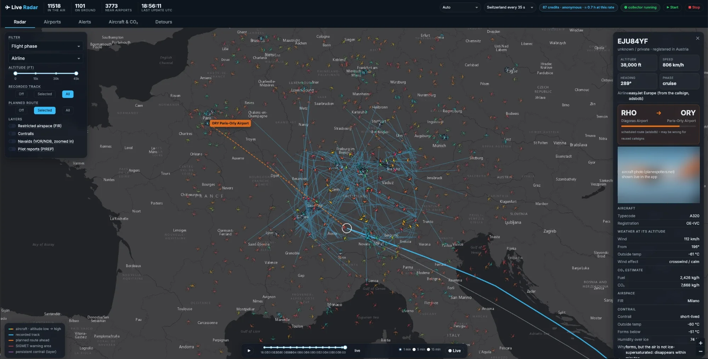

# ✈ Live flight tracking on your laptop

Build your own data pipeline for live aircraft positions: from a single call to the
[OpenSky Network](https://opensky-network.org) API to a database with **bronze, silver and gold** layers, analyses
of CO₂, weather, noise and train alternatives – and at the end a live map. Everything runs on your laptop:
[marimo](https://marimo.io) notebooks, one [DuckDB](https://duckdb.org) file, no cloud account.

**Who it is for:** anyone who knows a bit of Python and SQL and wants to learn data engineering on real, live
data – step by step, with a check after every exercise.

**What you get:** 20 notebooks as exercises (with hints and automatic checks) plus their solutions, a collector
that polls OpenSky in the background, a set of analysis jobs (weather, routes, CO₂, runways, holdings, go-arounds,
contrails, emergency squawks …) and the *Live Radar* map app.



<sub>The screenshot shows the world feed from the course author's private archive. Without an archive you see
Switzerland, collected live by your own laptop. Map tiles © Esri, HERE, Garmin, © OpenStreetMap contributors.</sub>

The project was built for a course at the Lucerne University of Applied Sciences and Arts (HSLU) in October 2026.
It is also the code behind the blog series
[Live Flight Data Step by Step](https://www.stefanko.ch/p/live-flight-data-1-opensky-network/), also on
[Medium](https://stefanko-ch.medium.com/live-flight-data-step-by-step-part-1-opensky-network-and-the-first-api-call-e3ff56e0dcb1).

---

## 1 · Setup (once, 5 minutes)

You need [uv](https://docs.astral.sh/uv/getting-started/installation/) – it installs Python and all packages.

```bash
git clone https://github.com/stefanko-ch/live-flight-tracking.git
cd live-flight-tracking
uv sync                         # Python + all packages into .venv
cp .env.template .env           # optional: your OpenSky API client, PHOTO_CONTACT (see below)
uv run marimo edit .            # opens the browser
```

In the browser, open **`tools/00_setup.py`** and press the **run button at the bottom right**. Every line should
turn green (yellow lines are optional).

> marimo does not run a notebook when you open it – press the run button once in every notebook.

**`.env` (optional).** Without it, everything works anonymously. Worth adding:

- `OPENSKY_CLIENT_ID` / `OPENSKY_CLIENT_SECRET` – a free [OpenSky account](https://opensky-network.org) →
  *Account* → *API client*. Ten times more credits (see below).
- `PHOTO_CONTACT` – your e-mail address; planespotters.net asks for a contact in every request. Empty = no
  aircraft photos in the map.
- `R2_*` – only if you run your **own** S3-compatible archive of OpenSky snapshots (see notebook 04). Leave them
  empty otherwise.

### OpenSky credits

Every call to OpenSky costs credits; one call for the Switzerland box costs **1 credit**
([API credits](https://openskynetwork.github.io/opensky-api/rest.html#api-credits)).

| | credits per day | at one call every 35 s |
|---|---|---|
| anonymous | about 400, **per IP address** (everyone behind the same router shares them) | about 3.9 hours of data |
| free account + API client in `.env` | 4,000 | the whole day (≈ 2,470 calls) |

When the credits are used up, OpenSky answers `429 Too Many Requests` until they are refilled; the collector waits
and retries.

---

## 2 · Collect data first

Notebooks 01–06 practise on small files of their own. **Notebooks 07–20 analyse `flights.duckdb`** – the data
*you* collect. Start collecting early and let it run for a few hours (a night and a day is even better):

```bash
uv run start.py        # collector + all analyses + the live map in your browser (Ctrl+C stops it)
# or, without the map:
uv run collector.py    # Switzerland every 35 s until Ctrl+C
```

Or open **`tools/88_start_everything.py`** and press **Start**. Only one of them at a time: DuckDB allows only
one process that writes to `flights.duckdb`. The notebooks work on a copy, so they run while the collector is
running.

Without data, notebook 07 stops with *No flight data in flights.duckdb yet*.

---

## 3 · The notebooks

Work in `exercises/`. Every gap is marked **TODO**, has a hint to fold out and a check below it: ❌ red until it is
right, then ✅ green.

| | Notebook | You learn |
|---|---|---|
| **Pipeline** | 01 First message | one API call, what a state vector is |
| | 02 Bronze | store raw data in DuckDB – without duplicates |
| | 03 Collector | a loop that runs for hours: credits, errors, rhythm |
| | 04 Backfill *(optional)* | load history from an archive and merge it – needs your own S3-compatible bucket; without one, the SQL part runs on your own data |
| | 05 Silver | clean data, airline names and aircraft categories – and the watermark trap |
| | 06 Gold | airports, current positions, approaches |
| **Analyses** | 07 Routes & detours | how far aircraft really fly |
| | 08 CO₂ | fuel and CO₂ per aircraft type and airline |
| | 09 Weather & contrails | wind and contrails at flight level |
| | 10 Analyses | night flights, top routes, fleet age, the Skyguide outage¹ |
| **Deeper** | 11 Plane or train | CO₂ per person, travel time by train |
| | 12 Who is overflown | municipalities, residents, noise contours |
| | 13 Ground weather | MeteoSwiss station Kloten vs. traffic |
| | 14 EUROCONTROL | your counts vs. the official numbers |
| | 15 Holidays | do school holidays fill the airport? |
| | 16 pycontrails | contrail models on a grid over Switzerland |
| | 17 Disruptions¹ | find outages automatically |
| | 18 Holdings & go-arounds¹ | what arriving aircraft do |
| | 19 Runways & wind | which runway, and why |
| **Finish** | 20 Dashboard | turn a notebook into an app with `marimo run` |

¹ TODO 10.5, notebook 17 and notebook 18 use the **Skyguide outage on the afternoon of 20 October 2026** as a case study. That
afternoon is in the course author's archive, which is not public. With your own data, these notebooks look at
your own recent hours instead, and the checks report what they find rather than failing.

Notebook 16 needs one extra package: `uv sync --group contrails`.

### Solutions

`solutions/` has the complete version of every notebook. The exercises are generated from them
(`uv run python make_exercises.py`), so both always match. Try first, then compare.

---

## 4 · The map (Live Radar)

```bash
uv run start.py
```

It collects Switzerland live from OpenSky, runs all analyses in the background, opens the map in your browser and
has a time slider to replay the hours you collected. Stop it with Ctrl+C (or **Stop** in
`tools/88_start_everything.py`).

The app loads its dark theme (Bootstrap *Darkly*) from a CDN (jsDelivr) and the map tiles from Esri and CARTO, so it needs internet
access like the rest of the project.

---

## 5 · When something goes wrong

| You see | What to do |
|---|---|
| `No flight data in flights.duckdb yet` | Collect data first (section 2), then rerun the notebook. |
| `Could not set lock on file "flights.duckdb"` | The app or `collector.py` is running and owns the file. Notebooks 07–20 work on a copy, so this only hits scripts – stop the other one first. |
| `429 Too Many Requests` | No OpenSky credits left. Anonymous: about 400 a day per IP address, shared with everyone behind it. Wait for the refill, call less often (`--interval`), or add a free OpenSky API client to `.env`. |
| A notebook shows code but no results | Press the run button at the bottom right. |
| A chart is empty or a check says "few" | Your data may cover only a few hours or only the night (Zurich has a night curfew) – let the collector run longer. |
| The map page does not open | Another program uses the port – `start.py` picks the next free one and prints it. |

When you are done, **`tools/99_cleanup.py`** shows what the project left on your laptop (databases, downloads,
your `.env`) and deletes what you tick. Or simply delete the whole folder.

---

## 6 · Data sources and their terms

This repository contains **no OpenSky data** and no other flight data – you collect it yourself. The three small
reference files in `data/` are described in [data/README.md](data/README.md). Everything else is downloaded at run
time into `cache/` (not committed). Each source keeps its own licence or terms; the MIT licence of this project
covers only the code and texts in this repository.

**OpenSky Network** – read the [terms of use](https://opensky-network.org/about/terms-of-use) yourself before you
collect. In short: the licence covers non-profit research and non-profit education only; any use by a
for-profit/commercial entity needs a written licence from OpenSky; use of the REST API in an operational capacity
(a live product, service or automated system, even internal) needs a written licence, regardless of non-profit
status; the data must not be passed on to others; publications using the data must cite Schäfer et al. 2014
("Bringing up OpenSky: A large-scale ADS-B sensor network for research", IPSN 2014) and send OpenSky a copy or
link. This project is meant for learning on your own laptop.

| Source | Used for | Terms |
|---|---|---|
| [OpenSky Network](https://opensky-network.org) REST API and [aircraft database](https://opensky-network.org/datasets/metadata/) | positions; aircraft type, operator, build year | [terms of use](https://opensky-network.org/about/terms-of-use), see above |
| [OurAirports](https://ourairports.com/data/) | airports, runways, navaids | public domain |
| [OpenFlights](https://openflights.org/data) `airlines.dat` | airline names | Open Database License (ODbL); derived works under a free licence, commercial use needs a licence from OpenFlights ([terms](https://openflights.org/data.php)) |
| [adsbdb](https://www.adsbdb.com) | scheduled routes per callsign | route data © David Taylor & Jim Mason; see the [adsbdb README](https://github.com/mrjackwills/adsbdb) |
| [planespotters.net](https://www.planespotters.net/photo/api) Photo API | aircraft photos in the map | their photo API terms (as read on 18 October 2026): contact in the User-Agent (`PHOTO_CONTACT`), photographer and link shown, no bulk use |
| [aviationweather.gov](https://aviationweather.gov/data/api/) (US NWS) | METAR, TAF, SIGMETs, pilot reports | no licence stated on the API page; keep requests limited (at most 100 per minute) |
| [Open-Meteo](https://open-meteo.com) | weather at flight level, contrails | data under CC BY 4.0 with a link to open-meteo.com ([licence](https://open-meteo.com/en/licence)); the free API is for non-commercial use only ([terms](https://open-meteo.com/en/terms)) |
| [MeteoSwiss open data](https://opendatadocs.meteoswiss.ch) | ground weather station Kloten (13) | CC BY 4.0, "Source: MeteoSwiss" ([terms](https://opendatadocs.meteoswiss.ch/general/terms-of-use)) |
| Swiss Federal Statistical Office (BFS) | municipality boundaries, STATPOP population per municipality and per hectare (12) | open use, source must be given |
| Canton of Zurich (WFS) / FOCA (BAZL) | noise contours of Zurich airport (12) | cite BAZL / Canton of Zurich |
| [EUROCONTROL Aviation Intelligence Portal](https://ansperformance.eu/data/) | airport traffic, CO₂ per state (14, 15) | reuse with EUROCONTROL named as source, not for commercial purposes, no modification without written permission ([disclaimer](https://ansperformance.eu/about/disclaimer/)). Notebook 14 also reads the JSON feed behind EUROCONTROL's traffic dashboard – an internal feed, not a documented API |
| [OpenHolidays API](https://www.openholidaysapi.org), [Nager.Date](https://date.nager.at) | school and public holidays (15) | no licence stated on the OpenHolidays site; check both sites before use |
| mobitool v3.1 (EnergieSchweiz / PSI) | CO₂ factors per passenger-km (11) | see [data/README.md](data/README.md) |
| [Natural Earth](https://www.naturalearthdata.com) | country borders | public domain |
| [VATSIM VAT-Spy Data Project](https://github.com/vatsimnetwork/vatspy-data-project) | FIR boundaries | CC BY-SA 4.0 |
| [EASA CZIBs](https://www.easa.europa.eu/en/domains/air-operations/czibs/) | curated list of restricted airspace (`enrichment/restricted_airspace.py`) | snapshot in code, check before use |
| Esri basemap tiles | map background | © Esri, HERE, Garmin, © OpenStreetMap contributors |
| CARTO basemaps (via Plotly) | background of the Plotly maps in the notebooks and the app's density view | © CARTO, © OpenStreetMap contributors |
| [OpenAP](https://openap.dev) (TU Delft) | fuel and CO₂ model (Python package) | LGPL-3.0 |

Each notebook names its sources where it uses them.

---

## Licence

Code and texts: [MIT](LICENSE), © 2026 Stefan Koch. Third-party data and services keep their own terms (section 6).
